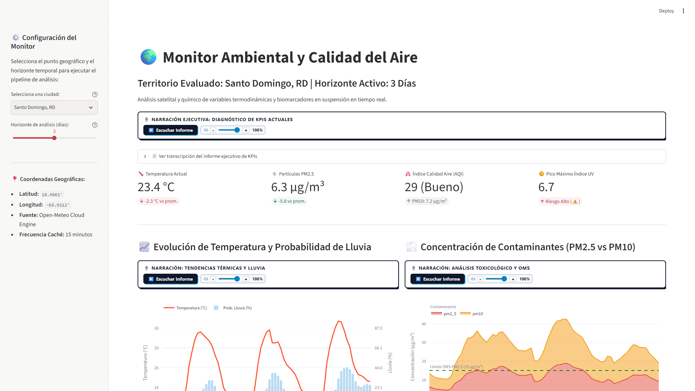

# ⛈️ Centro Meteorológico OpenWeatherMap Pro (v2.0)

[](https://share.streamlit.io/deploy?repository=JUANCITOPENA/centro-meteorologico-openweather&branch=main&mainModule=app.py)
[](https://github.com/JUANCITOPENA/centro-meteorologico-openweather)
[](https://python.org)
[](https://streamlit.io)
[](https://openweathermap.org/api)
[](https://opensource.org/licenses/MIT)

> **Plataforma Analítica Enterprise de Teledetección y Pronóstico Meteorológico** impulsada por los servicios REST de **OpenWeatherMap**, equipada con **Motor Heurístico de Narración Ejecutiva por Voz Humana (Web Speech API TTS)**, Rosa de los Vientos polar, termometría con sensación bioclimática, radar de precipitaciones y mapa de calor térmico horario.

---

## 🖼️ Galería Visual del Dashboard en Producción

### 1. Portada Principal: Tarjetas Bento de KPIs y Consola de Narración Ejecutiva


### 2. Evolución Térmica (Real vs Sensación) y Rosa de los Vientos Polar


### 3. Radar de Precipitaciones, Barómetro / Humedad y Mapa de Calor Térmico


---

## 📌 Tabla de Contenidos
1. [Visión y Capacidades Principales](#-visión-y-capacidades-principales)
2. [Gestión Segura de API Keys (Streamlit Cloud y GitHub)](#-gestión-segura-de-api-keys-streamlit-cloud-y-github)
3. [Motor de Inteligencia Narrativa e Interpretación Ejecutiva (TTS)](#-motor-de-inteligencia-narrativa-e-interpretación-ejecutiva-tts)
4. [Arquitectura del Pipeline de Datos (ETL)](#-arquitectura-del-pipeline-de-datos-etl)
5. [Manual de Traspaso Técnico para Desarrolladores](#-manual-de-traspaso-técnico-para-desarrolladores)
6. [Diccionario de Variables Meteorológicas](#-diccionario-de-variables-meteorológicas)
7. [Instalación Local y Despliegue en Streamlit Cloud](#-instalación-local-y-despliegue-en-streamlit-cloud)
8. [Estructura del Proyecto](#-estructura-del-proyecto)
9. [Créditos y Autoría](#-créditos-y-autoría)

---

## 🔬 Visión y Capacidades Principales

El **Centro Meteorológico OpenWeatherMap Pro** transforma datos satelitales crudos en inteligencia operativa para la toma de decisiones en transporte, logística, obras civiles y prevención de desastres naturales:
- **Búsqueda Geográfica Universal:** Geocodificación instantánea de cualquier ciudad del mundo con formato `Ciudad, CódigoPaís` (ej: `Santo Domingo, DO`, `Madrid, ES`, `Buenos Aires, AR`).
- **Resolución Trihoraria a 5 Días:** Monitoreo continuo de 40 marcas temporales proyectadas hacia el futuro.
- **Doble Fuente Telemetría:** Fusión en tiempo real del clima actual reportado por la estación en tierra y el modelo numérico de pronóstico a 5 días.
- **Termometría Bioclimática:** Contraste dinámico entre la temperatura del termómetro y la sensación térmica real percibida por el cuerpo humano.
- **Aerodinámica Eólica Avanzada:** Rosa de los vientos interactiva en coordenadas polares con categorización cardinal (N, NE, E, SE, S, SO, O, NO) y velocidad en km/h.
- **Barómetro y Psicrometría:** Vigilancia de caídas bruscas de presión atmosférica por debajo de 1010 hPa para detección temprana de perturbaciones ciclónicas o vaguadas.

---

## 🔐 Gestión Segura de API Keys (Streamlit Cloud y GitHub)

Uno de los principales problemas al desplegar aplicaciones con APIs de pago o tokens de acceso es el riesgo de filtraciones en repositorios públicos o caídas por claves faltantes. Este proyecto implementa una **resolución jerárquica blindada de 4 niveles**:

```
                              ¿Cómo resuelve la API Key el sistema?
                                                │
                 ┌──────────────────────────────┴──────────────────────────────┐
                 ▼                                                             ▼
        [Prioridad 1: Input Manual]                                   [Prioridad 2: Streamlit Cloud]
    Sidebar: Clave personalizada del usuario                   st.secrets["OPENWEATHER_API_KEY"]
                 │                                                             │
                 └──────────────┬──────────────────────────────┬───────────────┘
                                │ (Si no están definidas)      │
                                ▼                              ▼
                     [Prioridad 3: Env Var]           [Prioridad 4: Fallback]
                   os.getenv("OPENWEATHER_API_KEY")   Clave interna integrada funcional
```

### Configuración en Streamlit Community Cloud (Paso a Paso):
1. Al crear la app en [share.streamlit.io](https://share.streamlit.io/), ve a **Advanced Settings > Secrets**.
2. Pega la siguiente configuración:
   ```toml
   OPENWEATHER_API_KEY = "tu_api_key_de_openweathermap"
   ```
3. Guarda los cambios. El sistema leerá automáticamente la clave sin exponerla en el código fuente de GitHub.
*(Nota: Si no configuras los Secrets, el sistema usará el fallback integrado sin arrojar ningún error).*

---

## 🎙️ Motor de Inteligencia Narrativa e Interpretación Ejecutiva (TTS)

Cada bloque y visualización del panel cuenta con un **motor heurístico analítico** que redacta y sintetiza un dictamen técnico en voz alta mediante **Web Speech API**:

| Sección del Dashboard | Lógica de Narración e Interpretación |
| :--- | :--- |
| **Tarjetas Bento de KPIs** | Compara temperatura actual vs sensación térmica, analiza si la presión atmosférica (< 1010 hPa) anticipa mal tiempo y computa el acumulado pluvial de 5 días. |
| **Evolución Térmica** | Calcula la amplitud térmica ($\Delta T = T_{\max} - T_{\min}$) e identifica si el gradiente térmico día/noche demanda precauciones frente a choque térmico. |
| **Rosa de los Vientos** | Determina el cuadrante cardinal eólico predominante, la velocidad media por rumbo y emite alertas para faenas de altura ante ráfagas $\ge 30\text{ km/h}$. |
| **Radar de Precipitación y Nubosidad** | Audita el porcentaje medio de cobertura nubosa y alerta sobre la ventana horaria de máxima probabilidad pluvial. |
| **Barómetro y Humedad Relativa** | Diagnostica el comportamiento psicrométrico y emite alertas tempranas de inestabilidad barométrica. |
| **Mapa de Calor Horario** | Localiza con precisión la fecha y hora exacta del cénit de calor del ciclo para planificar jornadas laborales. |

### Controles Táctiles (Estándar JPV Pro):
- `[▶️ Escuchar Informe]`: Síntesis en español nativo con cadencia ejecutiva.
- `[⏸️ Pausar]`, `[⏯️ Reanudar]`, `[⏹️ Detener]`.
- **Ecualizador animado verde pulsante** con estado reactivo.
- **Control de volumen continuo** interactivo con botones `[-]` y `[+]` y slider de `0%` a `100%`.
- **Transcripción colapsable completa** para cumplimiento estricto de accesibilidad (**WCAG 2.2 AAA**).

---

## 👨‍💻 Manual de Traspaso Técnico para Desarrolladores

Si un nuevo desarrollador o equipo hereda este proyecto, estos son los puntos clave de arquitectura:

### 1. ¿Dónde se gestionan las llamadas HTTP a OpenWeatherMap?
En la función `obtener_datos_meteorologicos()` dentro de [`app.py`](file:///C:/Users/User/Desktop/CARPETA%20DE%20TRABAJO%20DE%20ANTIGRAVITY%20CLI-JPV/centro_meteorologico_openweather/app.py):
- Se consulta `https://api.openweathermap.org/data/2.5/weather` (condiciones actuales).
- Se consulta `https://api.openweathermap.org/data/2.5/forecast` (pronóstico de 5 días / 3 horas).
- Ambas llamadas cuentan con `timeout=12` para evitar cuelgues de sockets y captura de códigos HTTP `401` y `429`.

### 2. ¿Cómo agregar ciudades fijas en los accesos rápidos?
En `app.py` busca el diccionario `ciudades_rapidas` en la Sección 6:
```python
ciudades_rapidas = {
    "Personalizada": None,
    "Santo Domingo, DO": "Santo Domingo, DO",
    # Agrega tu ciudad aquí:
    "Tokio, Japón": "Tokyo, JP",
}
```

### 3. ¿Cómo regenerar las capturas de pantalla de la portada?
Ejecuta el script automatizado con Playwright:
```powershell
python scripts/capturar_dashboard.py
```
El script levantará Streamlit en background, abrirá Microsoft Edge headless, tomará las capturas a 1080p y las guardará en `docs/screenshots/`.

---

## 📊 Diccionario de Variables Meteorológicas

| Variable | Tipo de Dato | Origen OpenWeather | Definición y Unidad |
| :--- | :--- | :--- | :--- |
| `temperatura` | Float | `main.temp` | Temperatura termodinámica del aire a nivel de estación (°C). |
| `sensacion_termica` | Float | `main.feels_like` | Temperatura aparente combinando humedad y velocidad de viento (°C). |
| `humedad` | Int | `main.humidity` | Humedad relativa porcentual (0 - 100%). |
| `presion` | Int | `main.pressure` | Presión atmosférica reducida al nivel del mar (hPa). |
| `viento_kmh` | Float | `wind.speed * 3.6` | Velocidad del viento convertida de m/s a kilómetros por hora (km/h). |
| `direccion_viento` | Categorical | `wind.deg` | Rumbo eólico discretizado en 8 cuadrantes cardinales. |
| `prob_lluvia` | Float | `pop * 100` | Probabilidad de precipitación acumulada en la franja (0 - 100%). |
| `lluvia_mm` | Float | `rain.3h` | Volumen estimado de agua caída en milímetros (mm). |

---

## 🚀 Instalación Local y Despliegue en Streamlit Cloud

### 1. Ejecución Local (Windows)
```powershell
# 1. Clonar el repositorio
git clone https://github.com/JUANCITOPENA/centro-meteorologico-openweather.git
cd centro-meteorologico-openweather

# 2. Crear y activar entorno virtual seguro
python -m venv .venv
.\.venv\Scripts\activate

# 3. Instalar dependencias
pip install -r requirements.txt

# 4. Iniciar aplicación
streamlit run app.py
```
*O haz doble clic en el archivo:* [`iniciar_centro_meteorologico.bat`](file:///C:/Users/User/Desktop/CARPETA%20DE%20TRABAJO%20DE%20ANTIGRAVITY%20CLI-JPV/centro_meteorologico_openweather/iniciar_centro_meteorologico.bat)

### 2. Despliegue en Streamlit Community Cloud
1. Entra a: [https://share.streamlit.io/deploy](https://share.streamlit.io/deploy?repository=JUANCITOPENA/centro-meteorologico-openweather&branch=main&mainModule=app.py)
2. Repositorio: `JUANCITOPENA/centro-meteorologico-openweather`, rama: `main`, archivo: `app.py`.
3. Presiona **"Deploy!"** y estará en línea en segundos.

---

## 📁 Estructura del Proyecto

```
centro_meteorologico_openweather/
│
├── .venv/                              # Entorno virtual seguro de Python (ignorado en git)
├── .gitignore                          # Exclusión de archivos sensibles y temporales
├── app.py                              # Código fuente maestro con ETL, Voz TTS y Dashboards
├── requirements.txt                    # Dependencias oficiales sin fijación de versiones
├── README.md                           # Documentación técnica completa con capturas HD
├── STATUS.md                           # Bitácora de calidad, verificación y matriz de control
├── iniciar_centro_meteorologico.bat    # Script de arranque rápido en Windows con 1 clic
│
├── .streamlit/
│   ├── secrets.toml                    # Configuración de secretos local
│   └── secrets.toml.example            # Plantilla documentada para Streamlit Community Cloud
│
├── scripts/
│   └── capturar_dashboard.py           # Script Playwright para automatización de capturas HD
│
└── docs/
    └── screenshots/                    # Capturas HD del sistema en vivo
        ├── 01_hero_kpis_narrador.png
        ├── 02_evolucion_termica_rosa_vientos.png
        ├── 03_radar_lluvia_barometro_heatmap.png
        └── 00_dashboard_completo.png
```

---

## 🏛️ Créditos y Autoría

- **Arquitecto de Solución y Desarrollador Líder:** Ing. Juancito Peña Vizcaíno
- **Organización / Ecosistema:** Antigravity CLI / DataIADev Pro
- **Año:** 2026
- **Perfil de Autoría:** [https://github.com/JUANCITOPENA](https://github.com/JUANCITOPENA)
